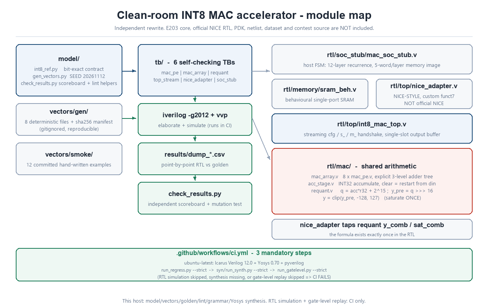
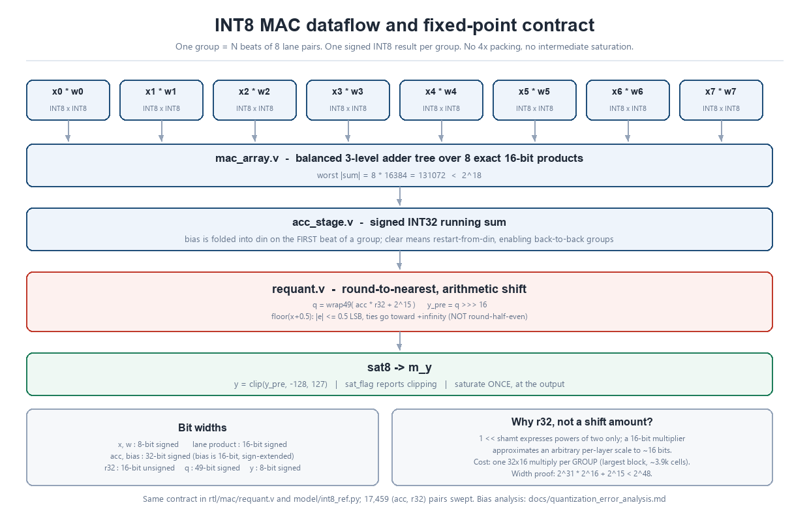
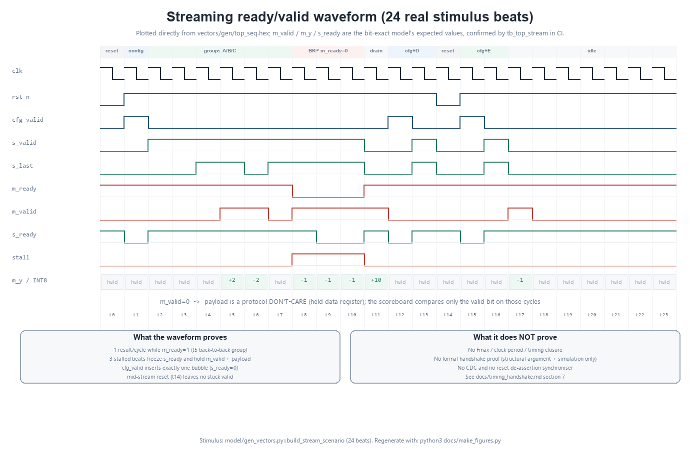
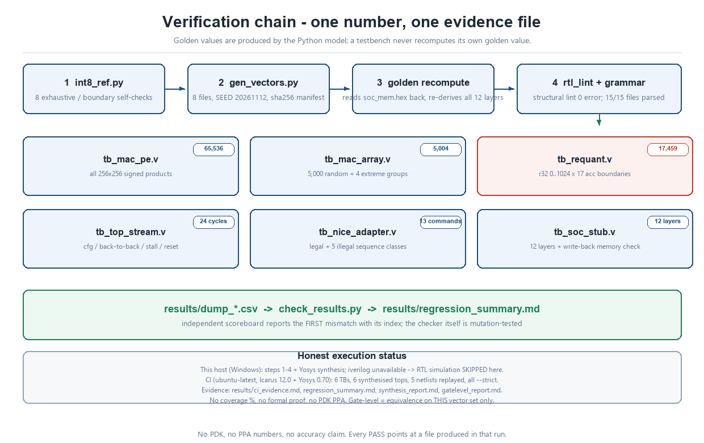
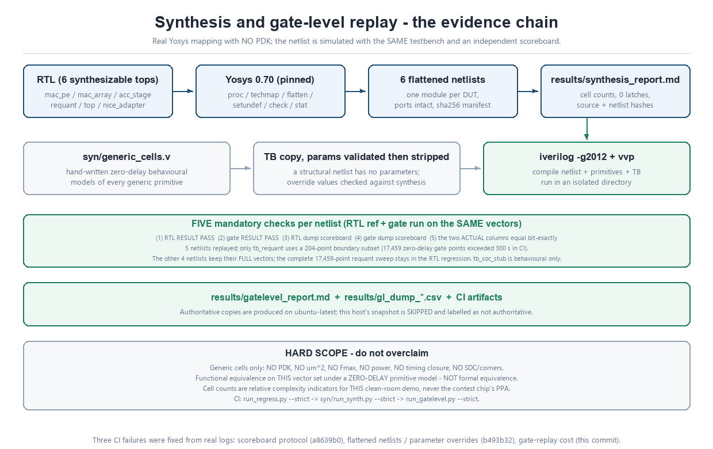

# E203-Based INT8 MAC Accelerator (clean-room demo)

**RTL Design · Fixed-Point Arithmetic · Functional Verification · Logic Synthesis**

[](https://github.com/dddeeehhh0-jpg/e203-int8-mac-accelerator/actions/workflows/ci.yml)

A small, independently written INT8 MAC channel: 8 parallel signed multiply
lanes, a 32-bit accumulator, `r32` requantization with round-to-nearest and a
single output saturation, plus a NICE-style command adapter and a minimal
host FSM that runs a 12-layer feed-forward chain end to end. Every datapath
rule has a bit-exact Python reference model, deterministic vectors and a
self-checking Verilog testbench.

This is a design-and-verification exercise: build a fixed-point datapath from
scratch, then show with reproducible evidence exactly what has and has not been
proved about it. There is no PDK, no STA, no coverage percentage and no PPA
claim.

> **This repository is not the contest project.** It contains no E203 core,
> no official NICE RTL, no PDK, no vendor/contest netlist, no dataset and no
> trained weights. The only netlists here are **generic** ones generated from
> this repository's own RTL into a gitignored build directory.
> See [What is NOT included](#what-is-not-included) and
> [docs/PUBLICATION_AUDIT.md](docs/PUBLICATION_AUDIT.md).

---

## How to read this repository

1. **What was designed and why** — [Why this design](#why-this-design),
   [Architecture](#architecture), [Fixed-point contract](#fixed-point-contract).
2. **How correctness is established** — [Verification](#verification),
   [Synthesis and gate-level replay](#synthesis-and-gate-level-replay),
   [Formal verification](#formal-verification).
3. **What is deliberately not claimed** — [What is NOT included](#what-is-not-included)
   and [docs/project_limitations.md](docs/project_limitations.md).
4. **Evidence and interview prep** — [Evidence map](#evidence-map-find-any-claim-in-30-seconds),
   [Evidence status](#evidence-status), [docs/interview_qa.md](docs/interview_qa.md).

The design comes first; the status index is at the end of this file.

---

## Why this design

- **INT8, not FP16** — activations and weights fit in one byte. Compared with
  FP16, INT8 halves the storage size per element, reducing the potential data
  bandwidth requirement for the same number of elements; actual traffic also
  depends on the access pattern, caching and data reuse. It also lets a lane be
  a single small multiplier. The premise is
  that quantisation error stays acceptable, which is why the requantizer is
  the most heavily tested module in this repository.
- **32-bit accumulator** — with 8 lanes, `|sum| <= 8 * 16384 = 131072 < 2^18`,
  so thousands of groups can be accumulated before a 32-bit accumulator is
  even close to overflow. No intermediate clipping, so truncation error does
  not compound across layers.
- **`r32` as a real multiplier, not a shift** — `1 << shamt` can only express
  powers of two. A 16-bit runtime scale approximates an arbitrary per-layer
  scale continuously. This is the one design decision with the most
  interview-relevant trade-off (one multiplier vs. much better scale fit).
- **One saturation, at the output** — saturating between layers would inject
  clipping error into the next layer's activations.

---

## Architecture



The host (`mac_soc_stub`) reads a 5-word-per-layer record from a behavioural
SRAM, configures the channel, pushes one group of 8 lane pairs, waits for the
INT8 result, feeds it back as the next layer's activations and writes all
results back to memory. `nice_adapter.v` is an alternative integration path:
a request/response command interface with explicit rejection of illegal
sequences. Both paths use the **same** `requant.v` arithmetic — the adapter
taps the module's combinational outputs instead of duplicating the formula.

---

## Fixed-point contract



```
acc   = sum_i(x_i * w_i) + bias          // wrap to signed 32 bits
q     = acc * r32 + 2^15                // wrap to signed 49 bits
y_pre = q >>> 16                        // ARITHMETIC right shift
y     = clip(y_pre, -128, 127)          // saturate ONCE
```

| Signal | Width | Format | Note |
|---|---|---|---|
| `x[i]`, `w[i]` | 8 | signed INT8 | lane `i` = `[i*8 +: 8]` |
| lane product | 16 | signed | `(-128)*(-128)=16384` still fits |
| `acc` | 32 | signed | includes bias, no intermediate clip |
| `r32` | 16 | unsigned | runtime scale, typically 1..1024 |
| `q` | 49 | signed | `2^31 * 2^16 + 2^15 < 2^48` |
| `y` | 8 | signed INT8 | `sat_flag` reports clipping |

`+2^15` makes it `floor(x+0.5)`: round-to-nearest with **ties toward
+infinity** (not round-half-even). `>>>` is an arithmetic shift, so it floors
negative intermediates rather than truncating toward zero. The r32-sweep
testbench checks both saturation boundaries, exact ties and full-scale
accumulator values explicitly. The rounding bias is derived in
[docs/quantization_error_analysis.md](docs/quantization_error_analysis.md);
full width proof in [docs/fixed_point_design.md](docs/fixed_point_design.md).



The waveform is generated from `vectors/gen/top_seq.hex`, not drawn by hand.
Backpressure, the config bubble, back-to-back groups and a mid-stream reset
are explained in [docs/timing_handshake.md](docs/timing_handshake.md).

---

## Verification



The rule is **one number, one evidence file**. Golden values are produced by
`model/int8_ref.py`; the testbenches never recompute them. A separate Python
scoreboard re-reads the RTL dumps so a bug inside a testbench cannot hide.

| Testbench | Coverage | Points |
|---|---|---|
| `tb_mac_pe` | all 256x256 signed products | 65,536 |
| `tb_mac_array` | 5,000 random groups + 4 extremes | 5,004 |
| `tb_requant` | r32 0..1024 + 32767/65535 x 17 acc boundaries | 17,459 |
| `tb_top_stream` | 24 cycle-accurate beats: cfg, back-to-back groups, stall, mid-stream reset | 24 |
| `tb_nice_adapter` | 1 legal sequence + 5 illegal classes | 13 commands |
| `tb_soc_stub` | 12-layer end-to-end, including write-back memory | 12 layers |

Real output from `python3 run_regress.py` on the author's host:

```text
PASS  mac_pe: all 65536 signed 8x8 products exact
PASS  requant: round-to-nearest boundary on positive and negative q
PASS  requant: arithmetic shift for negative intermediates
checker mutation test: PASS (errors=1, first=2)
PASS    pe_full.hex golden                  points=65536
PASS    array_rand.hex golden               points=5004
PASS    requant_scan.hex golden             points=17459
PASS    soc_expect.hex vs soc_mem.hex       points=12
PASS    nice_expect.hex golden              points=1
PASS    nice_seq.hex consistency            points=13
PASS    manifest.csv sha256                 points=8
[WARN] iverilog/vvp not found -> RTL simulation SKIPPED on this host.
  PASS     rtl_lint.py
  PASS     verilog_parse_check.py grammar
  SKIPPED  RTL simulation (6 TBs)
```

Real output from `python3 run_regress.py --strict` on GitHub Actions
(first green RTL run `43226906536`, commit `a8639b0`; reproduced in the latest
full-chain green run `43238295802`) — **this is the authoritative RTL result**:

```text
Icarus Verilog version 12.0 (stable)
RESULT tb_mac_pe PASS
RESULT tb_mac_array PASS
RESULT tb_requant PASS
RESULT tb_top_stream PASS
RESULT tb_nice_adapter PASS
RESULT tb_soc_stub PASS
PASS    dump_mac_pe.csv        points=65536  mismatches=0
PASS    dump_mac_array.csv     points=5004   mismatches=0
PASS    dump_requant.csv       points=17459  mismatches=0
PASS    dump_top_stream.csv    points=24     mismatches=0
PASS    dump_nice_adapter.csv  points=13     mismatches=0
PASS    dump_soc_stub.csv      points=12     mismatches=0
  PASS     RTL simulation (6 TBs)
  PASS     check_results.py (RTL dumps)
```

No coverage percentage is claimed: there is no commercial coverage tool in
this project. [docs/functional_coverage.md](docs/functional_coverage.md) is a
**scenario checklist**, not code coverage. See
[docs/verification.md](docs/verification.md) and
[`results/ci_evidence.md`](results/ci_evidence.md).

---

## Synthesis and gate-level replay



`syn/run_synth.py` runs a **real** Yosys generic mapping (no PDK) and flattens
each of the six synthesizable modules into a single structural netlist.
`run_gatelevel.py` then compiles those netlists with hand-written zero-delay
generic-cell models and the **same** testbenches, and runs an RTL reference
plus the gate-level version on the same vectors. Five checks must all pass
per TB, including a bit-exact comparison of the two ACTUAL columns. Full
details: [docs/synthesis_analysis.md](docs/synthesis_analysis.md) and
[`results/gatelevel_report.md`](results/gatelevel_report.md).

Because a zero-delay netlist expands the 32x16 multiplier into thousands of
gates, the gate-level requant sweep uses a 204-point boundary subset while the
**full 17,459-point sweep stays in the RTL regression**. This is an
equivalence experiment, not a second full regression.

---

## Formal verification

[`formal/README.md`](formal/README.md) documents a separate SymbiYosys flow
that adds two **scoped proofs** on top of the finite regressions, plus one
negative control for each so the assertions are known to be able to fail.

| Job | Object | Method | Result |
|---|---|---|---|
| `requant_comb` | `requant` combinational outputs | k-induction against an independently written 51-bit reference, over all 2^48 `(acc, r32)` pairs | PASS |
| `stream_protocol` | `int8_mac_top` protocol-control logic (abstracted datapath) | k-induction on 6 safety properties: reset, backpressure, cfg priority, `m_last` gating, stalled-output stability, accumulator hold | PASS |
| `requant_comb_bad` | rounding bias removed | BMC negative control | FAIL + VCD counterexample |
| `stream_protocol_bad` | `s_ready` forced high | BMC negative control | FAIL + VCD counterexample |

Run `python3 formal/run_formal.py --strict` (or `make formal`). CI runs the
same command: a proof that fails, a mutation that unexpectedly passes, or a
missing counterexample fails the workflow.

**What this is not:** **not** RTL-vs-netlist formal equivalence, **not**
full-chip verification, **not** a liveness/throughput proof and **not** a
coverage number. The sequential proof assumes one initial reset and an
abstracted (constant) data path; mid-stream reset is covered by
`tb_top_stream` instead. Gate-level replay remains a 204-point boundary
subset. Tool versions, commands, assumptions and source hashes are in
[`results/formal_report.md`](results/formal_report.md).

---

## Evidence map (find any claim in 30 seconds)

| Claim | Open this file |
|---|---|
| "six testbenches really passed" | [`results/ci_evidence.md`](results/ci_evidence.md) (run IDs, commit hashes, per-TB results) |
| "the netlist matches the RTL" | [`results/gatelevel_report.md`](results/gatelevel_report.md) |
| "synthesis is real" | [`results/synthesis_report.md`](results/synthesis_report.md) (cell counts, 0 latches, sha256) |
| "the scoreboard is not a rubber stamp" | `model/check_results.py --selftest` (2 mutation tests) |
| "the model is bit-exact" | `model/int8_ref.py`, `vectors/gen/manifest.csv` |
| "the ready/valid protocol satisfies the checked safety properties" | [`results/formal_report.md`](results/formal_report.md) + [`formal/README.md`](formal/README.md) |
| "the rounding bias is understood" | [docs/quantization_error_analysis.md](docs/quantization_error_analysis.md) |
| "the design trade-offs are deliberate" | [docs/design_tradeoffs.md](docs/design_tradeoffs.md) |
| "which scenarios are covered" | [docs/functional_coverage.md](docs/functional_coverage.md) |
| "the rounding rule holds for every input" | [`results/formal_report.md`](results/formal_report.md) + [`formal/README.md`](formal/README.md) |
| "the formal assertions can actually fail" | CI `formal-evidence` artifact (VCD counterexamples) |
| "I can defend this in an interview" | [docs/interview_qa.md](docs/interview_qa.md) (42 questions) |
| "nothing unauthorised is published" | [docs/PUBLICATION_AUDIT.md](docs/PUBLICATION_AUDIT.md) |
| "what is deliberately NOT done" | [docs/project_limitations.md](docs/project_limitations.md) |

---

## Evidence status

"Done" always points at a file you can open. This is an index; the sections
above explain what each line actually proves.

| Component | Status | Evidence |
|---|---|---|
| Bit-exact Python model | Done, 8 exhaustive self-checks | `model/int8_ref.py` |
| Deterministic vector corpus | Done, 8 files with sha256 | `vectors/gen/manifest.csv` |
| Independent golden recomputation | Done (88k+ points) | `model/check_results.py --verify-vectors` |
| 8 RTL modules + cell models | Written, grammar-parsed **15/15** | `results/parse_report.txt` |
| Structural lint | Done, 0 errors | `results/lint_report.txt` |
| 6 self-checking testbenches | **PASS, 6/6** in real simulation (Icarus Verilog 12.0) | [`results/ci_evidence.md`](results/ci_evidence.md) |
| Real logic-level synthesis | **Done** — Yosys 0.70, 6 flattened tops, 0 latches, 0 connectivity problems. **Generic cells only: no PDK, no PPA** | [`results/synthesis_report.md`](results/synthesis_report.md) |
| Post-synthesis gate-level replay | **Done** — 5 netlists, RTL-vs-netlist bit-exact on a 204-point boundary subset | [`results/gatelevel_report.md`](results/gatelevel_report.md) |
| Scoped formal proofs | **Done** — 2 k-induction proofs (1 combinational, 1 sequential) + 2 mutation counterexamples | [`results/formal_report.md`](results/formal_report.md), [`formal/README.md`](formal/README.md) |
| CI on Linux | **Green** — `--strict` regress / synthesis / gate-level steps plus a mandatory `formal` job | [`results/ci_evidence.md`](results/ci_evidence.md), `.github/workflows/ci.yml` |
| Design docs + interview Q&A | Done, 13 docs + formal README + 5 figures | `docs/`, `formal/README.md` |

**Honest caveat:** on the author's Windows host, `iverilog`/`vvp` could not be
installed (the OS security policy blocked the installer), so **RTL simulation
and gate-level replay were not run locally** — those local snapshots say
`SKIPPED` and are explicitly labelled *not authoritative*. The Python model,
vectors, golden recomputation, lint, grammar parse, the real Yosys synthesis
**and the formal proofs** did run on this host. All four evidence chains also
execute on GitHub Actions (`ubuntu-latest`). Full per-TB results, run IDs and
commit hashes are recorded in [`results/ci_evidence.md`](results/ci_evidence.md).

**Do not overclaim:** generic cell counts are NOT area in um^2, NOT Fmax and
NOT power. Gate-level replay is functional equivalence on a finite vector set,
not formal equivalence, not timing closure and not the contest chip. The two
formal proofs are scoped RTL properties — **not** RTL-vs-netlist equivalence,
**not** full-chip verification, **not** liveness/throughput and **not** a
coverage number. A successful synthesis run is not timing closure.

---

## What is NOT included

1. **No E203 core and no official NICE implementation.** `nice_adapter.v` is
   a simplified, independently written NICE-*style* adapter with its own
   funct7 encoding. Semantics are not the official ones.
2. **No PDK, no standard-cell library, no SRAM macro, no PPA.** The netlists
   here are *generic* gate-level structures produced by open-source Yosys for
   this clean-room demo; there is no area in um^2, no Fmax, no power, no STA,
   no timing closure. `sram_beh.v` and `mac_soc_stub.v` are behavioural and
   **excluded from synthesis**.
3. **No dataset, no trained weights, no audio.** All stimuli are generated
   deterministically from `SEED = 20261112`.
4. **No contest source code, no screenshots, no server paths.** The related
   team project is described only as method and conclusions in
   [docs/case_study.md](docs/case_study.md).
5. **No RTL-vs-netlist formal equivalence, no full-chip formal proof.** The
   formal work proves two scoped properties of this repository's RTL under the
   assumptions in [`formal/README.md`](formal/README.md). Gate-level replay is
   still a finite 204-point subset, not an equivalence proof.

---

## Quick start

`python3` alone runs the model, vectors, scoreboard, lint, grammar check and
**real Yosys synthesis** (via `yowasp-yosys`, a pip-installable build).
`iverilog` is required for RTL simulation and gate-level replay.

```bash
# Full evidence chain (the three --strict steps used by CI)
python3 -m pip install pyverilog "yowasp-yosys==0.70.0.0.post1259"
python3 run_regress.py --strict          # 6 TBs + scoreboard (needs iverilog)
python3 syn/run_synth.py --strict        # real generic-cell synthesis
python3 run_gatelevel.py --strict        # 5 netlists replayed (needs iverilog)
make ci                                 # same three steps
make formal                             # SVA + SymbiYosys proofs (needs z3)
make full                               # same, non-strict
```

`make formal` additionally needs an SMT solver (`sudo apt-get install -y z3`)
and the `yowasp-yosys` package installed above. It generates its own `.sby`
configs from the current RTL at run time; see
[`formal/README.md`](formal/README.md).

Host-side checks that need no simulator:

```bash
python3 run_regress.py                 # model/vectors/golden/lint/parse, sim SKIPPED
python3 syn/run_synth.py               # real synthesis + report
python3 model/check_results.py --verify-vectors --selftest
```

`--strict` turns a skipped simulation, a missing synthesis tool or a skipped
gate-level replay into a **failure**. A green CI badge therefore means all
three steps really ran on Linux. `make help` lists every target.

---

## Repository map

| Path | Contents |
|---|---|
| `rtl/mac/` | `mac_pe`, `mac_array`, `acc_stage`, `requant` |
| `rtl/top/` | `int8_mac_top` (streaming), `nice_adapter` (command path) |
| `rtl/memory/` | behavioural single-port SRAM |
| `rtl/soc_stub/` | minimal host FSM driving 12 layers |
| `model/` | reference model, vector generator, scoreboard, lint, grammar check |
| `tb/` | 6 self-checking Verilog testbenches |
| `vectors/smoke/` | 12 committed hand-written examples |
| `vectors/gen/` | generated corpus (gitignored, reproducible) |
| `syn/` | `run_synth.py` (real generic mapping), `generic_cells.v` (hand-written primitives), `synth_yosys.ys`, DC template |
| `run_gatelevel.py` | post-synthesis netlist replay with 5 mandatory checks per TB |
| `docs/` | 13 design/verification/interview docs; `make_figures.py` regenerates the 5 PNGs |
| `formal/` | SVA checkers, SymbiYosys driver, scope/limits README (run products in gitignored `formal/out/`) |
| `results/` | lint / parse / regression / synthesis / gate-level / formal / CI-evidence reports |

### Design deep-dives (for interview prep)

- [timing_handshake.md](docs/timing_handshake.md) — ready/valid equations, no-loop argument, backpressure, latency/throughput, waveform.
- [quantization_error_analysis.md](docs/quantization_error_analysis.md) — rounding bias, error bounds, width proof, saturation.
- [design_tradeoffs.md](docs/design_tradeoffs.md) — why 8 lanes / 32-bit acc / real `r32` multiply, critical path, what I would rebuild.
- [functional_coverage.md](docs/functional_coverage.md) — scenario checklist (explicitly **not** code coverage).
- [synthesis_analysis.md](docs/synthesis_analysis.md) — what the real synthesis does and does not prove.
- [interview_qa.md](docs/interview_qa.md) — 42 questions with answers and hard "do not say" lines.
- [project_limitations.md](docs/project_limitations.md) / [case_study.md](docs/case_study.md) / [resume_project.md](docs/resume_project.md).

---

## Related work

Only the *organisation* of these repositories was studied; no code, figure or
README text was copied.

- [riscv-mcu/e203_hbirdv2](https://github.com/riscv-mcu/e203_hbirdv2) — Apache-2.0, the upstream E203 SoC (not vendored here).
- [GregAC/tiny-nn](https://github.com/GregAC/tiny-nn) — the `rtl / dv / model` split and a two-level testbench structure.
- [AnilS454/pe-asic-sky130](https://github.com/AnilS454/pe-asic-sky130) — writing optimisation as a causal chain rather than a bare percentage.

---

## License

MIT, see [LICENSE](LICENSE). The generic holder "Project contributors" is
used deliberately so the public repository carries no personal identity.
