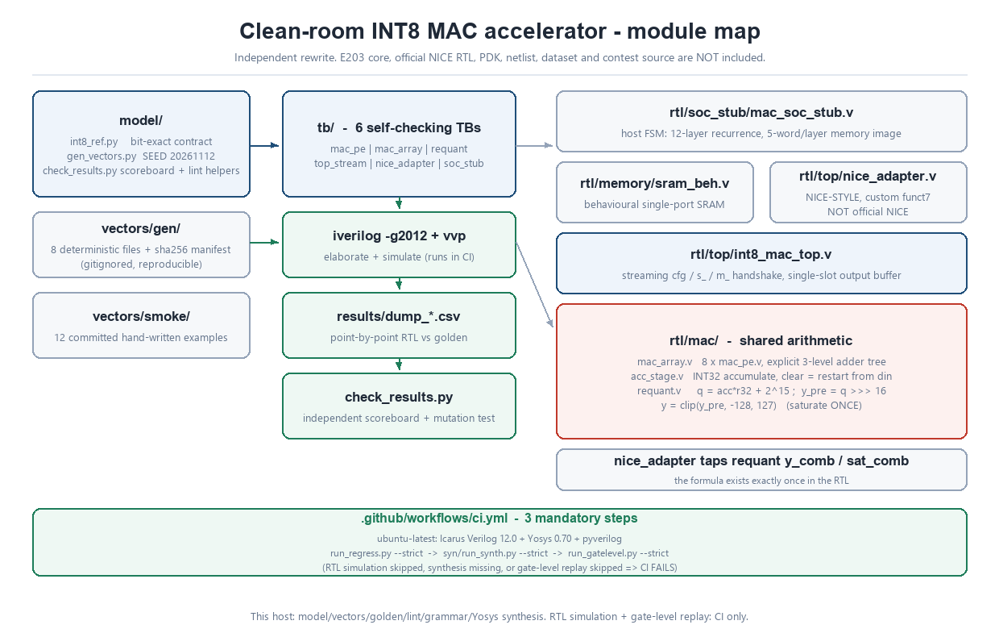
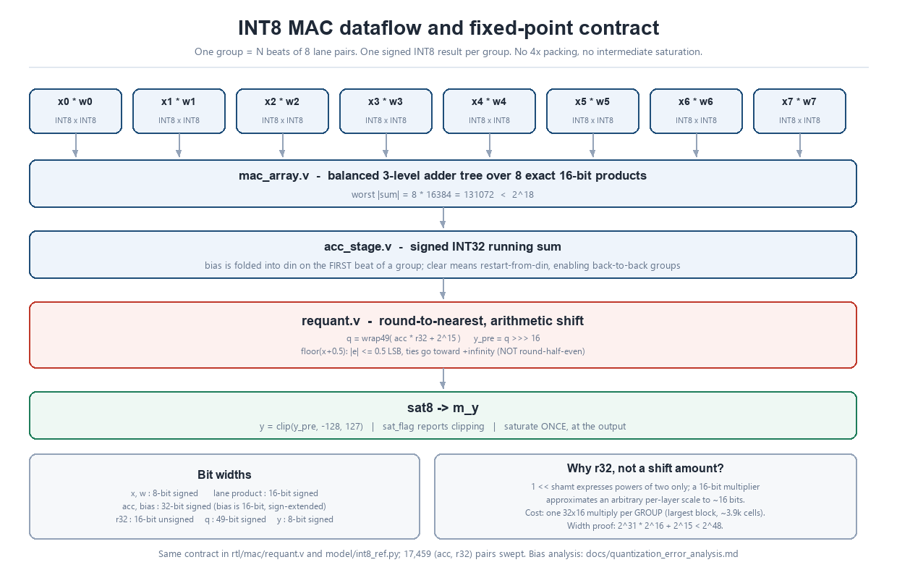
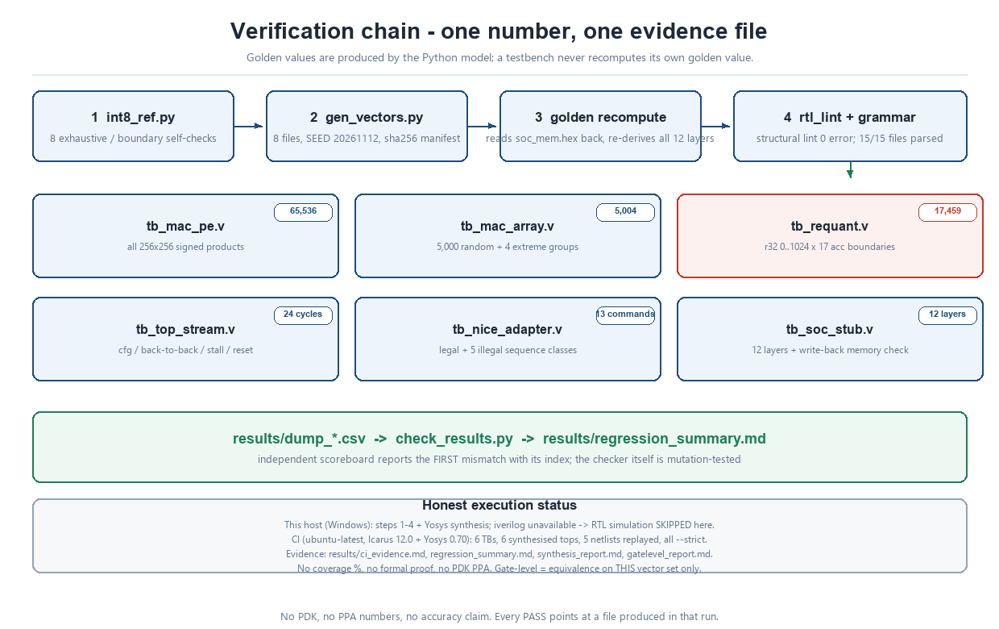
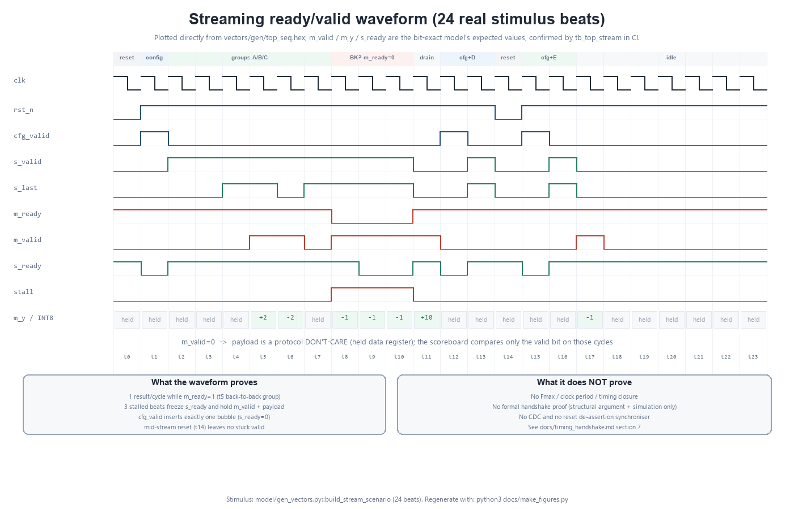
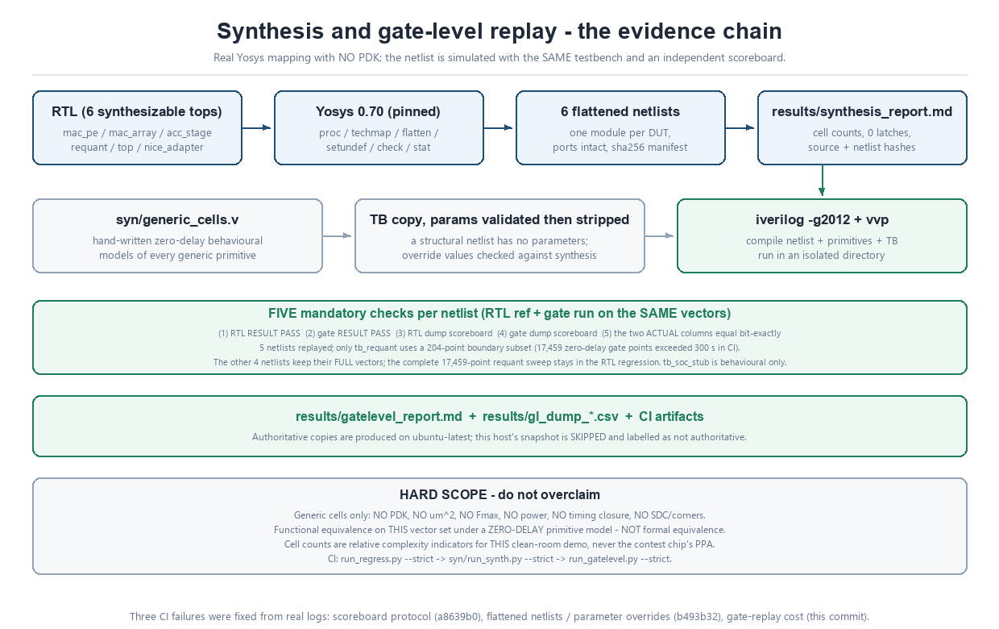

# 基于 E203 的 INT8 MAC 加速器（clean-room 演示工程）

[](https://github.com/dddeeehhh0-jpg/e203-int8-mac-accelerator/actions/workflows/ci.yml)

*仓库为 Private 时，badge 仅登录用户可见。*

独立重写的小型 INT8 MAC 数据通路：8 路并行有符号乘法、32 位累加、`r32`
再量化（四舍五入 + 单次输出饱和），另有一个 NICE 风格指令适配器，以及一个
能跑通 12 层前馈链的最小宿主 FSM。每条数据通路规则都配有位精确 Python
参考模型、可复现向量和自检 testbench。

> **本仓库不是比赛工程**：不含 E203 核、官方 NICE RTL、PDK、厂商/比赛网表、
> 数据集、权重、比赛源码与截图。仓库里唯一的网表是由本工程自己的 RTL
> 用 Yosys 生成的 generic 网表，落在 gitignore 的构建目录里、不作为源文件提交。
> 比赛经历只在 `docs/case_study.md` 里写方法与结论。

英文主入口见 [README.md](README.md)。

---

## 状态表（先看这个）

| 组件 | 状态 | 证据 |
|---|---|---|
| 位精确 Python 模型 | 已完成，8 项穷举自检 | `model/int8_ref.py` |
| 确定性向量集 | 已完成，8 个文件含 sha256 | `vectors/gen/manifest.csv` |
| 独立黄金值复核 | 已完成（8.8 万+ 点） | `check_results.py --verify-vectors` |
| 8 个 RTL 模块 + 单元模型 | 已写，语法解析 **15/15** | `results/parse_report.txt` |
| 结构 lint | 已完成，0 error | `results/lint_report.txt` |
| 6 个自检 testbench | **CI 真实仿真 6/6 全 PASS**（Icarus Verilog 12.0） | `results/ci_evidence.md` |
| 真实逻辑级综合 | **已跑** — Yosys 0.70，6 个展平顶层，0 latch，0 连接问题。**仅 generic cells，无 PDK、无 PPA** | `results/synthesis_report.md` |
| 综合后门级回放 | **已跑** — 5 个网表与 RTL 逐点一致 | `results/gatelevel_report.md` |
| Linux CI 回归 | **全绿** — 3 个 `--strict` 步骤：回归 / 综合 / 门级回放 | `results/ci_evidence.md`、`.github/workflows/ci.yml` |
| 设计文档 + 面试手册 | 13 份文档 + 5 张图 | `docs/` |

**如实说明**：作者本机的 `iverilog` 安装包被 Windows 安全策略拦截，
**RTL 仿真与门级回放未在本机执行**（本机快照写 `SKIPPED` 并注明「不权威」）。
本机真实跑通的是模型、向量、黄金值复核、lint、语法解析，以及**真实的 Yosys 综合**。
六个 TB、综合与网表回放都在 GitHub Actions（`ubuntu-latest`，Icarus 12.0 +
Yosys 0.70）执行。三次「先失败后修复」的 CI 记录（scoreboard 协议、展平网表/
参数覆盖、门级回放耗时）都在 `results/ci_evidence.md`。

**不要越界**：generic cell 数不是面积 um²、不是 Fmax、不是功耗；门级回放是
有限向量集上的功能等价，不是形式等价、不是时序收敛，也不是比赛芯片。

---

## 定点契约

```
acc   = sum_i(x_i * w_i) + bias          // 32 位有符号回绕
q     = acc * r32 + 2^15                // 49 位有符号
y_pre = q >>> 16                        // 算术右移，不是逻辑右移
y     = clip(y_pre, -128, 127)          // 只在输出级饱和一次
```

| 信号 | 位宽 | 说明 |
|---|---|---|
| `x[i]`, `w[i]` | 8 | 有符号 INT8 |
| 单 lane 乘积 | 16 | `(-128)*(-128)=16384` 仍装得下 |
| `acc` | 32 | 含 bias，中途不截断 |
| `r32` | 16 | 运行时比例因子，非 2 的幂也可表达 |
| `q` | 49 | `2^31 * 2^16 + 2^15 < 2^48` |
| `y` | 8 | 有符号 INT8，`sat_flag` 报告饱和 |

`+2^15` 使结果变成 `floor(x+0.5)`：四舍五入，但**平局朝 +∞**（不是
round-half-even），负数一侧有方向性偏置；`>>>` 是算术右移，对负数取 floor
而非向零截断。误差上界、偏置与饱和分析见
`docs/quantization_error_analysis.md`。`r32` 用真乘法而不是移位，才能逼近
任意层比例。









波形图直接由 `vectors/gen/top_seq.hex` 绘制，不是手画：反压时 `s_ready`
拉低、整条流水线冻结，配置周期插入 1 拍气泡。推导见 `docs/timing_handshake.md`。

---

## 验证

| Testbench | 覆盖 | 点数 |
|---|---|---|
| `tb_mac_pe` | 256x256 全组合 | 65,536 |
| `tb_mac_array` | 5,000 随机 + 4 组极值 | 5,004 |
| `tb_requant` | r32 全扫 x 17 个 acc 边界 | 17,459 |
| `tb_top_stream` | 24 拍：配置、背靠背、反压、流中复位 | 24 |
| `tb_nice_adapter` | 1 组合法 + 5 类非法序列 | 13 |
| `tb_soc_stub` | 12 层端到端 + 写回内存复核 | 12 |

**不声称覆盖率数字**（没有商用覆盖率工具就不编）。`docs/functional_coverage.md`
是**场景清单**，不是代码覆盖率。每个数字都指向 `results/` 或
`vectors/gen/manifest.csv` 里的具体文件。

---

## 综合与门级回放



`syn/run_synth.py` 用 Yosys 真实综合（无 PDK），把 6 个可综合模块展平成结构化
网表；`run_gatelevel.py` 用**自写**的零延迟 generic cell 行为模型编译网表，
在**同一份向量**上分别跑 RTL 参考与网表，每个 TB 必须通过五重校验（含两份
dump 的 ACTUAL 列逐点比对）。因为零延迟网表把 32x16 乘法展开成数千个门，
门级 requant 扫描用 204 点边界子集，**完整的 17,459 点仍在 RTL 回归里跑**。
详见 `docs/synthesis_analysis.md` 与 `results/gatelevel_report.md`。

---

## 证据地图（30 秒定位任何结论）

| 结论 | 打开这个文件 |
|---|---|
| 六个 TB 真的通过了 | `results/ci_evidence.md`（run ID、commit hash、逐 TB 结果） |
| 网表与 RTL 一致 | `results/gatelevel_report.md` |
| 综合是真的 | `results/synthesis_report.md`（cell 数、0 latch、sha256） |
| scoreboard 不是橡皮图章 | `model/check_results.py --selftest`（2 项变异测试） |
| 握手不会死锁 | `docs/timing_handshake.md` + `fig4` |
| 舍入偏置讲得清 | `docs/quantization_error_analysis.md` |
| 设计权衡是有意的 | `docs/design_tradeoffs.md` |
| 覆盖了哪些场景 | `docs/functional_coverage.md` |
| 经得起面试追问 | `docs/interview_qa.md`（42 问） |
| 没公开不该公开的东西 | `docs/PUBLICATION_AUDIT.md` |
| 明确没做什么 | `docs/project_limitations.md` |

---

## 快速开始

```bash
# 完整证据链（CI 用的三个 --strict 步骤）
python3 -m pip install pyverilog "yowasp-yosys==0.70.0.0.post1259"
python3 run_regress.py --strict          # 6 个 TB + scoreboard（需 iverilog）
python3 syn/run_synth.py --strict        # 真实 generic-cell 综合
python3 run_gatelevel.py --strict        # 5 个网表回放（需 iverilog）
make ci                                 # 等价于上面三步
```

不需要仿真器的本机检查：

```bash
python3 run_regress.py                 # 模型/向量/黄金值/lint/语法，仿真 SKIPPED
python3 syn/run_synth.py               # 真实综合 + 报告
python3 model/check_results.py --verify-vectors --selftest
```

`--strict` 会把「仿真跳过 / 综合工具缺失 / 门级回放跳过」一律判为失败，
所以 CI 绿灯代表三步都在 Linux 上真跑过。`make help` 列出全部目标。

---

## 明确不包含

1. E203 核与官方 NICE 实现：`nice_adapter.v` 是自定义 funct7 编码的简化版。
2. PDK、标准单元库、SRAM 宏、**PPA**：这里的网表是开源 Yosys 对 clean-room
   工程做的 generic 门级结构，没有 um² / MHz / mW、没有 STA 与时序收敛。
   `sram_beh.v` 与 `mac_soc_stub.v` 是行为级，**不参与综合**。
3. 数据集、训练权重、音频：所有激励由 `SEED = 20261112` 确定性生成。
4. 比赛源码、截图、服务器路径：见 `docs/PUBLICATION_AUDIT.md` 的三色清单。

---

## 文档索引

| 文件 | 内容 |
|---|---|
| `docs/architecture.md` | 模块划分、接口表、模式编码 |
| `docs/fixed_point_design.md` | 位宽推导、舍入与饱和证明 |
| `docs/quantization_error_analysis.md` | 舍入偏置、误差上界、饱和率、位宽证明 |
| `docs/timing_handshake.md` | ready/valid 形式化、反压、延迟/吞吐、波形图 |
| `docs/design_tradeoffs.md` | 决策表、面积-吞吐权衡、关键路径、重做优先级 |
| `docs/functional_coverage.md` | 功能场景清单（**不是**代码覆盖率） |
| `docs/interview_qa.md` | 42 问面试追问手册，含口径红线 |
| `docs/verification.md` | 六个 TB、向量机制、证据链 |
| `docs/synthesis_analysis.md` | 真实综合与门级回放能/不能说明什么 |
| `docs/project_limitations.md` | 已知限制与未做事项 |
| `docs/case_study.md` | 比赛团队项目：只写方法与结论 |
| `docs/resume_project.md` | 简历 3 行版与面试八问 |
| `docs/PUBLICATION_AUDIT.md` | 逐文件合规清单 |

---

## 许可证

MIT，见 [LICENSE](LICENSE)。发布前请把版权人改成自己的名字。
